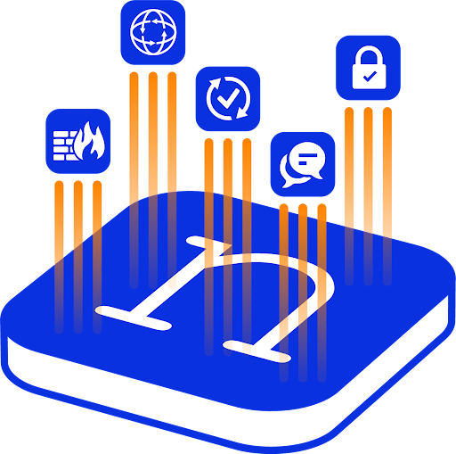
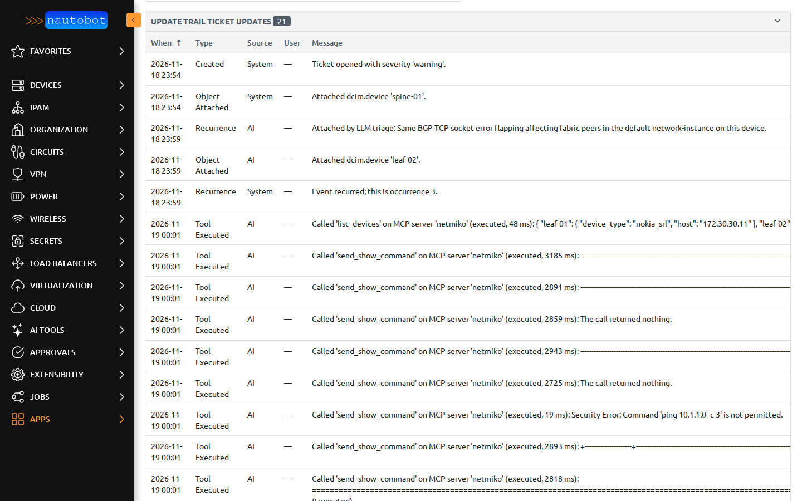

# Event Tracker

  
   
  
  
  
  
   
  An <a href="https://networktocode.com/nautobot-apps/">App</a> for <a href="https://nautobot.com/">Nautobot</a>.

## Overview

Event Tracker turns network events into tickets in Nautobot. A consumer process reads events from a message broker. It keeps the events that matter and opens a ticket for each one. Repeat events join the open ticket.

Each ticket keeps an update trail. Every change to a ticket adds one entry to the trail. The app never changes or deletes an entry, so the trail is a complete record of the ticket.

You can also turn on four optional features:

- LLM triage decides if an event needs a ticket.
- An agent reads a ticket and writes its findings on the ticket. A person must approve each action that can change the network.
- Retrieval shows closed tickets that look like the open ticket.
- A dashboard shows ticket counts and the cost of model calls.

The [Using the App](https://nautobot-app-event-tracker.readthedocs.io/en/latest/user/app_use_cases/) page shows more screenshots.

## Documentation

The full documentation is on the [Read the Docs](https://nautobot-app-event-tracker.readthedocs.io/en/latest/) site:

- [User Guide](https://nautobot-app-event-tracker.readthedocs.io/en/latest/user/app_overview/) - Overview, Using the App, Getting Started.
- [Administrator Guide](https://nautobot-app-event-tracker.readthedocs.io/en/latest/admin/install/) - Install, configure, upgrade, or uninstall the App.
- [Developer Guide](https://nautobot-app-event-tracker.readthedocs.io/en/latest/dev/contributing/) - Extend the App, Code Reference, Contribution Guide.
- [Release Notes / Changelog](https://nautobot-app-event-tracker.readthedocs.io/en/latest/admin/release_notes/).
- [Frequently Asked Questions](https://nautobot-app-event-tracker.readthedocs.io/en/latest/user/faq/).

### Contributing to the Documentation

The Markdown source of the documentation is in the [`docs`](https://github.com/jtdub/nautobot-app-event-tracker/tree/develop/docs) folder of this repository. For a small change, edit the files in a Markdown editor.

To see the built site, start the documentation container with the `invoke` commands. The [Development Environment Guide](https://nautobot-app-event-tracker.readthedocs.io/en/latest/dev/dev_environment/#docker-development-environment) has the details. The site is at [http://localhost:8001](http://localhost:8001). The container rebuilds each page when you save it.

Pull requests with fixes or improvements are welcome.

## Questions

First, read the [FAQ](https://nautobot-app-event-tracker.readthedocs.io/en/latest/user/faq/). Then ask in the [Network to Code Slack](https://networktocode.slack.com/), in the channel `#nautobot`. If you have no account, [sign up here](http://slack.networktocode.com/).
