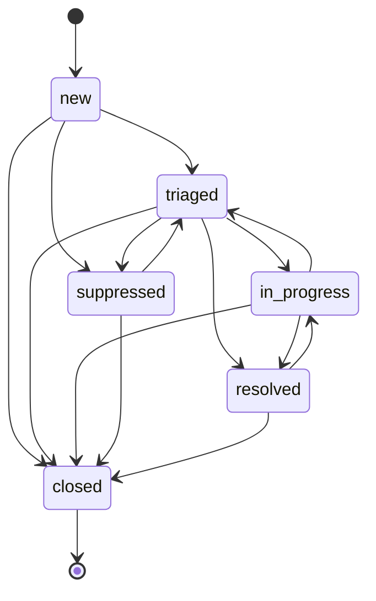

# Using the App

Event Tracker turns network events into tickets. Each ticket keeps its own history. This page describes the ticket lifecycle: the states of a ticket, the transitions between them, and the fields that you cannot edit.

## The ticket lifecycle

A ticket is always in one of six states.

| State | Meaning |
| --- | --- |
| **New** | The ticket is open. Nobody looked at it yet. |
| **Triaged** | The event is real. It needs work. |
| **In Progress** | Somebody works on the ticket now. |
| **Suppressed** | The event is noise. The ticket stays on the record. Nobody works on it. |
| **Resolved** | The problem is fixed. Nobody confirmed the fix yet. |
| **Closed** | The work is finished. This state is final. |

The workflow does not allow all transitions between the states:

Read these three rules before you start:

**Closed is final.** No transition leaves it. You cannot reopen a closed ticket. If you closed a ticket by mistake, open a new ticket. This rule keeps the limits on AI actors simple.

**Resolved is not final.** A resolved ticket can go back to In Progress when the fix did not hold. The transition clears the resolution and the resolved time. The ticket then shows no old answer.

**New cannot go directly to Resolved.** Triage the ticket or work on it first. If the event is not a problem, transition the ticket to Suppressed or Closed.

## Transition a ticket {#moving-a-ticket}

Use the **Transition** menu on the ticket page. The menu shows only the transitions that the workflow allows from the current state. If a transition is not in the menu, the workflow does not allow it now. A user without the transition permission sees no transition in the menu.

You must give a resolution when you transition a ticket to Resolved. The form does not accept the transition without a resolution. The resolution tells the next reader how the problem ended.

### Why Status is not on the edit form

The ticket edit form has no Status field. A REST `PATCH` that sets the status fails with an error. The app does not ignore it. This is intentional.

Each transition must follow the diagram. Each transition must add an entry to the update trail. The app must also stop an AI actor when it tries to change a finished ticket. The app can give these guarantees only when each transition goes through one place. That place is the transition. You use the **Transition** menu or the REST transition action.

The same rule applies to Resolved At, Closed At, Resolution and Event Count. The app sets these fields when a ticket transitions.

You can edit severity and assignee on the ticket like other fields. The app adds an entry to the update trail for each change. The entry shows who made the change and the old value. This is true for the edit form and for a REST `PATCH`.

The bulk edit form of the web interface has no severity field and no assignee field. Nautobot saves a bulk edit directly on each object. The app cannot add an entry to the update trail in that case. To change severity or assignee on many tickets, use the bulk `PATCH` of the REST API. The app adds an entry for each ticket.

### Permissions

To transition a ticket, a user needs the **Can transition event ticket status** permission (`transition_eventticket`). This permission is separate from the ordinary change permission. Use this to let a first-line team transition tickets without a right to change ticket content.

## Comments and the update trail

The **Update Trail** panel of a ticket page lists each change to the ticket.

The update trail is the complete history of the ticket. It shows when somebody opened the ticket. It also shows each comment, transition, assignment and attachment.

**Nobody can edit or delete an entry.** No route of the app can change or delete an entry. If an entry is wrong, add a comment that says so. The app never erases an event.

Each entry records who acted and what kind of actor it was: a person, an AI, or automation. The entries of AI and automation never have a username. An automated action cannot look like an action of a person.

To add a comment, use the REST API action `tickets/<id>/comment/`. The web interface has no comment button. The **Note** field of the transition form adds a note to the entry of the transition.

## Attach network objects {#attaching-network-objects}

A ticket points to the real object in Nautobot. It does not describe the object. Use **Attach Object** on the ticket page to link one of these objects:

- device
- interface
- IP address
- prefix
- cable
- circuit
- location

First, choose the kind of object. Then choose the object in the type-ahead picker. The ticket page shows the attached objects in groups by type. Each object is a link. While the ticket is open, each object has a control to detach it.

A detach does not erase the attach. The update trail shows both events. This is useful. For example, the trail can show that a person suspected an interface at 03:14 and cleared it at 04:02.

An administrator sets which object types you can attach. See [Install and Configure](../admin/install.md).

## Where tickets come from

These sources open a ticket:

- A person.
- A script that uses the REST API.
- The event consumer. This process reads network events from a broker. It opens tickets for the events that need work.

The **Source** field of a ticket shows which source opened it. Each entry of the update trail shows the source of that entry. The app records an event that arrives automatically as **System**. It never records such an event as a person.

An automatic ticket holds the raw event in its payload. You can see what the device sent. An administrator sets which events become tickets and which events the app discards as noise. See [Running the Event Consumer](../admin/ingestion.md).

Some events open directly in **Suppressed**. A rule does this for events that are known noise. The ticket stays on the record, and nobody works on it. For example, a link goes down and up again and again on a device that a person already repairs. The update trail shows which rule did it.

A rule never changes a ticket after the ticket exists. Assume that you triage a suppressed ticket and start work. A later event that matches the rule does not transition the ticket back.

**Apps > Event Tracker > Ingestion Stats** shows what the consumer did lately. It shows how many events arrived and how many became tickets. It also shows how many events each rule discarded. Look at this page when you expected a ticket and did not get one.

## Repeat events

A ticket can have a **dedup key**. A new event can have the same key as an open ticket. The app then does not open a second ticket. It adds one to the event count of the open ticket and updates its Last Seen. It also adds a recurrence entry to the update trail.

This stops when the ticket is resolved or closed. The next event with the same key opens a new ticket. A problem that comes back after a fix is new information. It is not a continuation of the old problem.

## Find tickets {#finding-tickets}

You can filter the ticket list by these fields:

- status
- severity
- source
- event type
- assignee
- dates
- event count
- dedup key

Two filters need more explanation:

- **Is open** shows each ticket that is not resolved or closed.
- **Attached object type (app_label.model)** shows tickets that have an object of this type attached now. A ticket does not match when a user attached the object and then detached it.

The REST API and GraphQL have each filter of the web interface.
